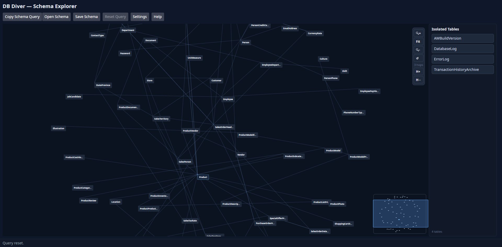
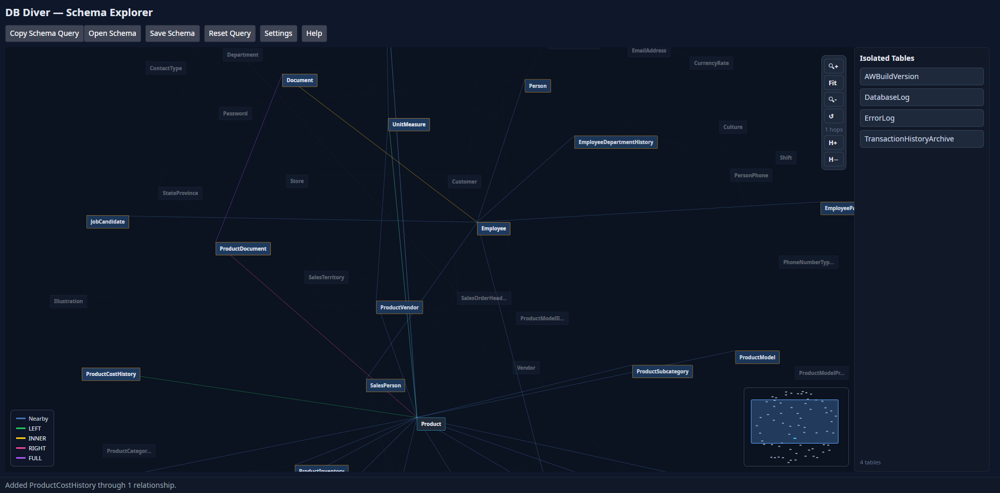

# DB Diver

DB Diver assists in navigating SQL Server database schemas and finding join paths. It displays the database schemas in an interactive graph UI that allows for seeing nearby tables, assists in finding join paths with two clicks, and builds out the joins needed to run any queries.

**Initial Schema View:** 

**Query Building View:**

## ✨ Features

- **Schema Graph UI:** Graph UI that displays the connections between database tables. Click, drag, and scroll around your database's schema. 
- **Automated Query Building:** Simply click on different tables within the UI to build out the join path you need.
- **Custom Join Paths:** Allows for creating custom join paths if the schema does not have it. 
- **Join Path Search:** Allows for automated join path finding by selecting one table and searching for another.
- **Multiple Join Types:** Supports all join types, change by left-clicking on the path to cycle through them.
- **Cross-Platform Support:** Built with Avalonia, DB Diver should work with all operating systems (currently, only tested on Linux)
- **Customizable:** Don't like the color scheme or the graph physics? Simply change them within the settings menu.

## 🚀 Getting Started

Download the application from the releases page and run! The application provides the query needed to build the ingested .csv schema file. 

## 💻 Usage

1. Run the .exe file and select "Copy Schema Query". Run against your database and save the result as a .csv file. 
2. Open the .csv file within DB Diver
3. Controls
    - Left Click on any table to see the nearby tables (as defined by joins). 
        - You can change the distance of nearby tables by changing the amount of "hops" you want to traverse. 
    - Right Click on any table to see a context menu
        - Add Custom Join Path: Left-click onto a table that you want to add a custom join path for, you will be presented with a modal that asks you for the column names on both sides of the join 
        - Build Query: This starts the query-building process. Left click on any tables you want to add to the join. If there are multiple paths to take from Table A -> B, you will be presented with a menu to select the option you would like the app to take. 
        - Finish Query: Finishes the query-building process and presents a `SELECT *` statement with the joins you added
        - Find a Table From Here: Opens a type-ahead search field with all the tables in the database and automatically finds the shortest path to the table. 
4. Extras
    - Save custom schemas for later use. 
    - Customize all the colors used in the application and the attraction and repulsion physics of the graph UI. 
    - Viewport controls
        - Zoom in, fit-to-screen, zoom out, reset view. 
        - Change hop count to alter how many tables the UI will traverse to show nearby tables

## 🗺️ Feature Roadmap
1. Add direct database connections
2. WHERE Clause building
3. UNION and subquery support 

## 📝 License 

Copyright © 2026 Thomas VanderBruggen

Permission is hereby granted, free of charge, to any person obtaining a copy of this software and associated documentation files (the “Software”), to deal in the Software without restriction, including without limitation the rights to use, copy, modify, merge, publish, distribute, sublicense, and/or sell copies of the Software, and to permit persons to whom the Software is furnished to do so, subject to the following conditions:

The above copyright notice and this permission notice shall be included in all copies or substantial portions of the Software.

THE SOFTWARE IS PROVIDED “AS IS”, WITHOUT WARRANTY OF ANY KIND, EXPRESS OR IMPLIED, INCLUDING BUT NOT LIMITED TO THE WARRANTIES OF MERCHANTABILITY, FITNESS FOR A PARTICULAR PURPOSE AND NONINFRINGEMENT. IN NO EVENT SHALL THE AUTHORS OR COPYRIGHT HOLDERS BE LIABLE FOR ANY CLAIM, DAMAGES OR OTHER LIABILITY, WHETHER IN AN ACTION OF CONTRACT, TORT OR OTHERWISE, ARISING FROM, OUT OF OR IN CONNECTION WITH THE SOFTWARE OR THE USE OR OTHER DEALINGS IN THE SOFTWARE.

## ✉️ Contact

Thomas VanderBruggen - thomas@tvanderbruggen.com

Project Link: [DB Diver on GitHub](https://github.com/thomasvanderbruggen/DBDiver)
